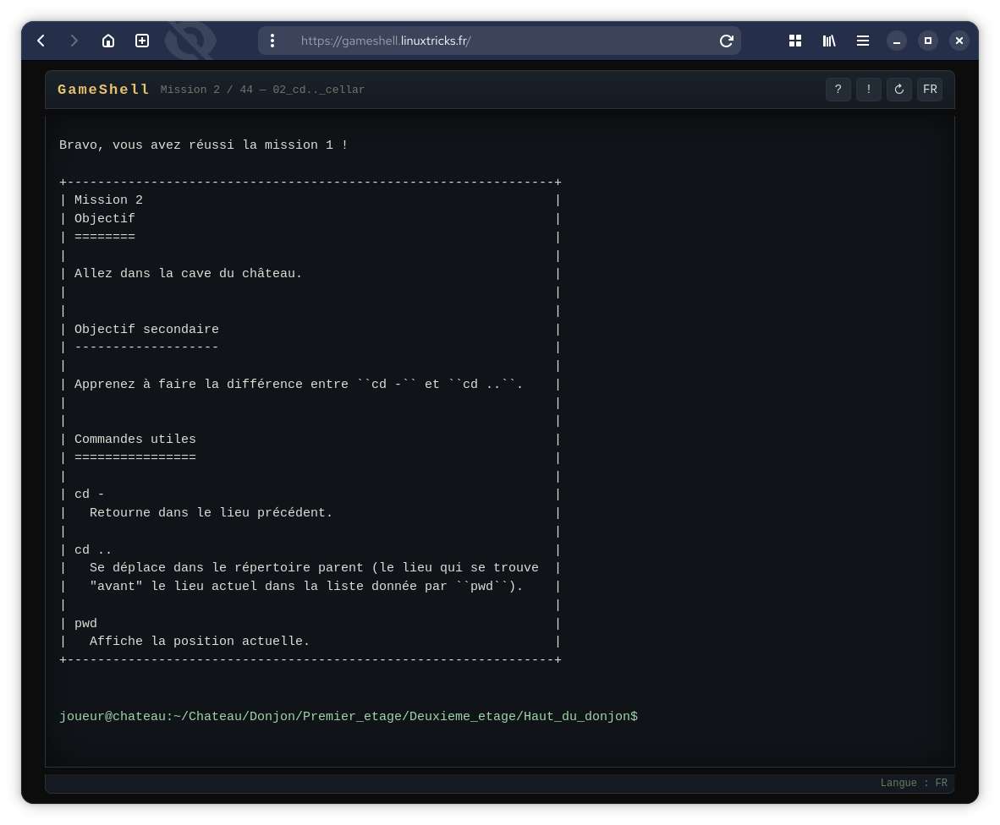

# GameShell-web

## Intro 

Version jouable dans le navigateur du jeu [GameShell](https://github.com/phyver/GameShell),
un jeu pour apprendre les commandes du shell Unix en s'amusant.

- 44 missions (la mission `xeyes` a été volontairement exclue).
- Interface : HTML + CSS + JavaScript pur (aucune dépendance).
- Langue : **anglais** par défaut, **français** automatique si la langue du
  navigateur est française (bouton `EN`/`FR` en haut à droite pour changer).
- Progression : sauvegardée dans un **cookie** du navigateur (1 an).

## Lancer le jeu

Le plus simple est de servir le dossier avec un petit serveur HTTP,
mais hébergeable aussi sur un apache ou nginx :

```sh
cd web
python3 -m http.server 8000
# puis ouvrir http://ip_du_serveur:8000/
```

Les commandes `gsh goal`, `gsh check`, `gsh reset`, `gsh help`, ... sont disponibles.

## Commandes du jeu

| Commande      | Description                                    |
|---------------|------------------------------------------------|
| `gsh goal`    | afficher l'objectif de la mission en cours     |
| `gsh check`   | vérifier que l'objectif est atteint            |
| `gsh reset`   | réinitialiser la mission en cours              |
| `gsh help`    | aide courte                                    |
| `gsh skip`    | abandonner la mission et passer à la suivante  |
| `gsh goto N`  | aller directement à la mission N               |
| `gsh index`   | liste des missions avec leur statut            |
| `gsh stat`    | statistiques                                   |
| `gsh exit`    | quitter (et sauvegarder) — ou `Ctrl-D`         |

Raccourcis clavier : `Tab` (complétion), `↑`/`↓` (historique),
`Ctrl-L` (effacer l'écran), `Ctrl-C` (interrompre).

## Captures d'écran



## Tests

```sh
node test.js          # tests unitaires (FS, shell, missions)
node playthrough.js   # résolution automatique des 44 missions
```
